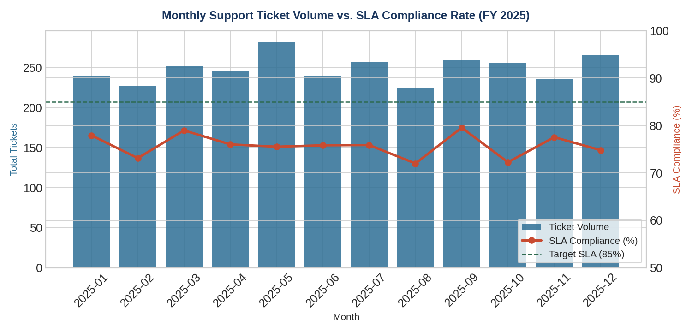
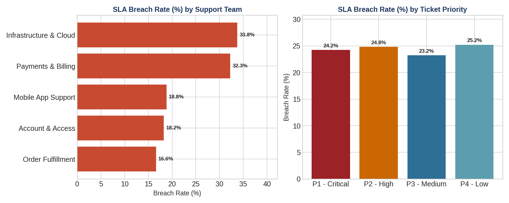
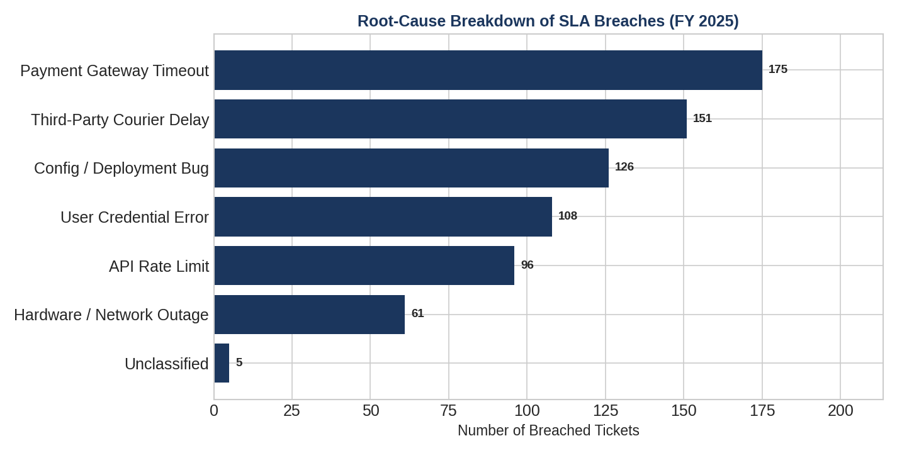

# 🛠️ Operations & Support SLA Analytics Engine (FY 2025)


> **A full-lifecycle IT & Customer Operations analytics project** built to monitor ticket volume, Mean Time to Resolution (MTTR), SLA breach rates across priority tiers, CSAT degradation, and root-cause Pareto drivers—complete with SQL window-function analytics, automated Python QA, and an executive Excel dashboard.

---

## 📑 Table of Contents
1. [Executive Overview & Business Problem](#-executive-overview--business-problem)
2. [Architecture & Data Pipeline](#-architecture--data-pipeline)
3. [Operational KPI Scorecard (FY 2025)](#-operational-kpi-scorecard-fy-2025)
4. [Repository Structure](#-repository-structure)
5. [Data Validation & Quality Assurance](#-data-validation--quality-assurance)
6. [Visual Insights & Bottleneck Analysis](#-visual-insights--bottleneck-analysis)
7. [Actionable Recommendations](#-actionable-recommendations)
8. [Quickstart & Reproducibility](#-quickstart--reproducibility)
9. [Limitations & Production Roadmap](#-limitations--production-roadmap)

---

## 🎯 Executive Overview & Business Problem
High-growth support organizations often suffer from silent SLA breaches buried inside raw ticketing exports (Zendesk / Jira Service Management), compounded by duplicate ticket logs and timestamp sync anomalies.

This project delivers an **evidence-based SLA monitoring framework**:
- **Primary Stakeholders:** Head of Customer Operations, Support Team Leads, Site Reliability / Engineering Managers.
- **Core Objective:** Pinpoint exact queues and recurring root causes driving SLA breaches, quantify the direct CSAT cost of missed SLAs, and enable targeted staffing and engineering interventions.

---

## 🏗️ Architecture & Data Pipeline

```text
┌───────────────────────────┐     ┌──────────────────────────────┐     ┌──────────────────────────────┐
│   1. Ticket Log Ingestion │     │   2. QA & SLA Scoring Layer  │     │   3. Reporting & Root Cause  │
│                           │     │                              │     │                              │
│ support_tickets_raw.csv   │────▶│ src/sla_etl_and_validation.py│────▶│ sql/02_sla_root_cause.sql    │
│ (3,022 raw tickets)       │     │ sql/01_ticket_cleaning_view  │     │ outputs/Operations_SLA.xlsx  │
└───────────────────────────┘     │  • Deduplication & Sync Fix  │     │ outputs/charts/*.png         │
                                  │  • Priority SLA Scoring      │     └──────────────────────────────┘
                                  └──────────────────────────────┘
```

---

## 📊 Operational KPI Scorecard (FY 2025)

| Operational Metric | FY 2025 Result | Interpretation |
| :--- | :---: | :--- |
| **Total Validated Tickets** | **2,986** | Clean post-QA annual ticket volume |
| **Overall SLA Compliance Rate** | **75.82%** | Share of tickets resolved within target SLA |
| **Total SLA Breaches** | **722** *(24.18%)* | Tickets exceeding priority SLA threshold |
| **Mean Time to Resolution (MTTR)** | **18.47 hrs** | Mean resolution time *(Median: 13.11 hrs)* |
| **Average First Response Time** | **3.97 hrs** | Mean time to initial agent response |
| **CSAT (SLA Met vs. Breached)** | **4.16 vs. 2.40** | **-1.76 pt** CSAT drop when SLA is breached |

### Team-Level Breach Leaderboard
| Support Team | Tickets | SLA Breaches | Breach Rate | MTTR (Hrs) | Avg CSAT |
| :--- | :---: | :---: | :---: | :---: | :---: |
| **Infrastructure & Cloud** | 545 | 184 | **33.76%** | 20.78 | 3.60 |
| **Payments & Billing** | 722 | 233 | **32.27%** | 21.82 | 3.56 |
| **Mobile App Support** | 537 | 101 | **18.81%** | 16.35 | 3.83 |
| **Account & Access** | 466 | 85 | **18.24%** | 16.69 | 3.77 |
| **Order Fulfillment** | 716 | 119 | **16.62%** | 16.08 | 3.92 |

---

## 📂 Repository Structure

```text
Project_2_Operations_SLA_Analytics/
├── README.md                                  # Project overview & technical documentation
├── data/
│   ├── raw/
│   │   └── support_tickets_raw.csv            # Raw ticket export with realistic DQ anomalies
│   └── processed/
│       └── support_tickets_clean.csv          # Validated, SLA-scored ticket dataset
├── sql/
│   ├── 01_ticket_cleaning_view.sql            # Deduplication, duration QA & SLA flag view
│   └── 02_sla_root_cause_analytics.sql        # Team leaderboard, CSAT delta & Pareto SQL
├── src/
│   └── sla_etl_and_validation.py              # Automated Python validation & scoring script
├── outputs/
│   ├── Operations_SLA_Dashboard.xlsx          # Multi-tab interactive Excel BI workbook
│   └── charts/
│       ├── 01_monthly_volume_vs_sla.png
│       ├── 02_team_and_priority_breaches.png
│       └── 03_root_cause_breach_pareto.png
└── docs/
    ├── requirements_and_kpi_spec.md           # SLA tier policies & KPI definitions
    ├── validation_report.md                   # Automated DQ audit evidence
    └── executive_summary.md                   # Ops leadership findings & action plan
```

---

## 🛡️ Data Validation & Quality Assurance
Every ticket record passed through 4 automated QA checks (`3,022` raw → `2,986` validated):
- **Duplicate Ticket IDs Removed:** `22` records
- **Negative Resolution Durations Filtered:** `14` records *(clock-sync errors)*
- **Missing Root Causes Imputed (`Unclassified`):** `35` records
- **Missing CSAT Survey Responses Preserved as NULL:** `18` records *(prevents downward bias in CSAT averages)*

Full audit trail: [`docs/validation_report.md`](docs/validation_report.md).

---

## 🖼️ Visual Insights & Bottleneck Analysis

### 1. Monthly Ticket Volume vs. SLA Compliance Trend


### 2. SLA Breach Rate by Support Team & Ticket Priority


### 3. Root-Cause Pareto of Breached Tickets


> 💡 **Interactive Workbook:** Open `outputs/Operations_SLA_Dashboard.xlsx` to test the **Priority Dropdown Filter** (`Cell C8`), conditional formatting rules (highlighting teams >25% breach rate), and embedded charts.

---

## 🚀 Actionable Recommendations
1. **Proactive 75% SLA Warning Triggers:** Configure automated escalation alerts for `P1 - Critical` and `P2 - High` tickets in **Infrastructure & Cloud** before breaches occur.
2. **Targeted Root-Cause Remediation:** Prioritize engineering fixes for **Payment Gateway Timeout** (24.24%) and **Third-Party Courier Delay** (20.91%), which drive nearly half of total operational breaches.
3. **Protect Customer Retention:** Because SLA breaches slash CSAT by **1.76 points**, tie team incentives to P1/P2 compliance rather than raw ticket closure count alone.

---

## ⚡ Quickstart & Reproducibility

```bash
# 1. Clone the repository
git clone https://github.com/<your-username>/operations-sla-analytics.git
cd operations-sla-analytics

# 2. Install dependencies
pip install pandas numpy openpyxl matplotlib

# 3. Run the automated validation & SLA scoring pipeline
python src/sla_etl_and_validation.py

# 4. Run SQL analytics
# Execute sql/01_ticket_cleaning_view.sql followed by sql/02_sla_root_cause_analytics.sql
```

---

## 🗺️ Limitations & Production Roadmap
- **Current Limitation:** Resolution hours measure wall-clock time (24x7) rather than business-hours-only calendars; agent-level shift schedules are excluded.
- **Next Steps for 10x Scale:**
  - Stream live Zendesk / Jira webhooks via **Kafka/Airflow** into a warehouse for near-real-time SLA breach forecasting.
  - Add a **Business-Hours Calendar Dim Table** in SQL to pause SLA timers during non-working holidays for P3/P4 tickets.
  - Build a lightweight **Logistic Regression / XGBoost breach-risk classifier** to flag high-risk tickets at creation time.
